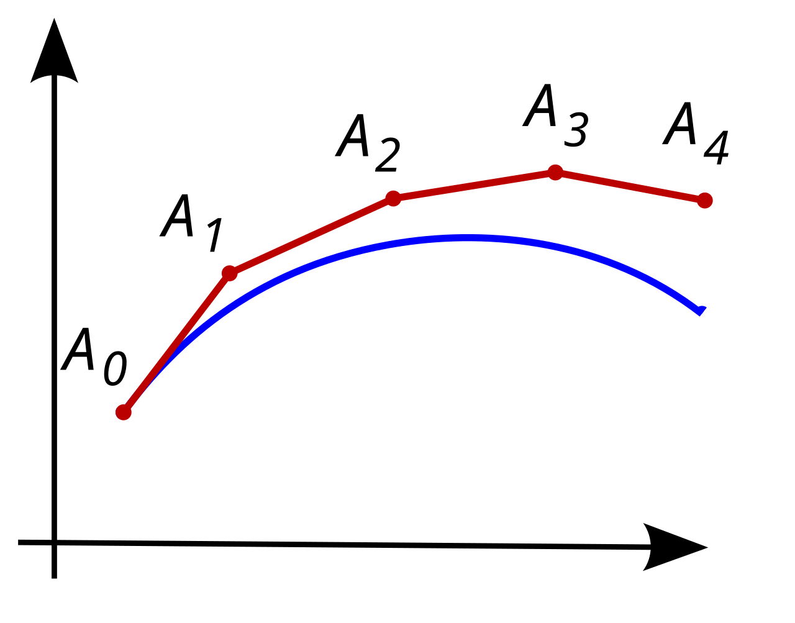

---
contents:
  - "Algorithmes de calcul numérique"
reading_time: "30 minutes"
ai_image: "../../assets/images/ia/IA_NIA.png"
report_url: "https://forms.office.com/r/ccF1FGKW25"
summary: "Présente le fonctionnement de la méthode d'Euler pour résoudre une équation différentielle."
---

La méthode d'Euler est un algorithme numérique qui permet d'approximer le résultat d'une équation différentielle de premier ordre (qui ne fait intervenir que la dérivée première). Comme on est en présence d'une équation différentielle, on ne peut pas toujours connaitre la fonction initiale. Toutefois, l'idée de la méthode est d'utiliser le fait que la valeur de la dérivée peut servir à approximer la valeur de la fonction localement.

Le schéma d'Euler explicite est le suivant : pour une équation différentielle $y'(x) = c(x)y(x)$ avec $c(x) et y(x)$ continues et différentiables sur un intervalle $[a, b]$ et une condition initiale $y(a) = y_0$ connue, alors pour un pas $h$ fixé, la suite suivante converge vers $y(b)$.

$$
y_{i+1} = y_{i} + h \times y'_{i} \approx y_{i} + h \times c(x_i)y_i, \text{ avec } x_i = a + ih 
$$

{ width=600 }
/// caption
Approximation par la méthode d'Euler. Tiré de [Illustration of the Euler Mehode](http://en.wikipedia.org/wiki/Euler_method#/media/File:Euler_method.svg)
///

La suite des points $A_i$ correspond aux $y_i$ qui seront calculés.

## Exemple 1

Par exemple, on souhaite calculer la valeur de $y(1)$. On ne connait pas $y$, mais on sait que $y'(x) = 2y(x)$ et que $y(0) = 1$. On utilise un pas $h$ de $0.5$.

**Étape 1** : poser les valeurs connues

- $y_0$ = 1
- $h$ = 0.5 (2 étapes de calcul)
- $y'_i = 2y_i$

**Étape 2** : effectuer le calcul

$$
\begin{align*}
y_1 &= y_0 + h \times y'_0 \\\\
&= 1 + 0.5 \times 2y_0 \\\\
&= 1 + 0.5 \times 2 \times 1 \\\\
&= 2
\end{align*}
$$

$$
\begin{align*}
y_2 &= y_0 + h \times y'_1 \\\\
&= 1 + 0.5 \times 2y_1 \\\\
&= 2 + 0.5 \times 2 \times 2 \\\\
&= 4
\end{align*}
$$

**Étape 3** : solution 

Donc $y(1) \approx 4$. 

La valeur réelle est 7,39, mais, comme un très grand pas est utilisé, il est normal d'avoir une erreur importante. La fonction ici était $y(x) = 2e^{x}$. 


## Exercice 1

Appliquez la méthode d'Euler avec l'équation suivante $y'(x) = \frac{y(x)}{2}$ et $y(0) = 2$. Approximez la valeur de $y(0.6)$ avec un pas $h$ de $0.2$

??? info "Solution"

    $$
    \begin{align*}
        y_0 &= 2 \\\\
        y_1 &= 2 + 0.2 \times \frac{2}{2} = 2.2 \\\\
        y_2 &= 2.2 + 0.2 \times \frac{2.2}{2} = 2.42 \\\\
        y_3 &= 2.42 + 0.2 \times \frac{2.42}{2} = 2.662
    \end{align*}
    $$

    Donc $y(0.6) = 2.662$. 

    La valeur réelle est 2.35, la fonction est $y(x) = e^{\frac{x}{2}}+1$

## En code

La méthode d'Euler peut être implémentée de la façon suivante pour le problème précédent.

```python title="Calcul de la méthode d'Euler" linenums="1"
def euler(a, b, nb_etapes):
    y_i = 2                             
    h = (b-a)/nb_etapes
    
    for i in range(nb_etapes):
        y_i1 = y_i + h * (0.5 * y_i)
        y_i = y_i1

    return y_i
        
print(euler(0, 0.6, 3))
```

La variable `y_i` prend les différentes valeurs d'approximation. On l'initialise à 2 à cause de la condition initiale du problème. On calcule ensuite le pas avec le nombre d'étapes et l'intervalle. Ensuite, on boucle pour le nombre d'étapes déterminées.

La ligne 6 représente la formule de la méthode d'Euler. À droite de l’égalité, on a le calcul de la prochaine étape. Comme un ordinateur travaille de façon séquentielle, toute la partie de droite est calculée **avant** l'affectation. On voit donc l'usage de la valeur précédente et du pas. On a remplacé la pente de la dérivée de l'étape précédente par son approximation (`0.5 * y_i`) due à l'équation différentielle donnée.

## Exercices

1. Modifiez le programme précédent pour résoudre le problème suivant : $y'(x) = 4y(x) + 2$ avec $y(0) = 2$ comme condition initiale. Trouvez la valeur de $y(1)$ avec un pas de 0.01.

??? success "Solution"

    125.7624

2. Résolver le problème  $y'(x) = x \times y(x)$ avec $y(0) = 1$ comme condition initiale. Trouvez la valeur de $y(1)$ avec un pas de 0.01.

??? success "Solution"

    1.6378


3. Soit un objet dont la vitesse varie dans le temps. La vitesse (m/s) est égale au produit du cosinus du temps écoulé par la position. L'équation régissant la vitesse `v` en fonction de la position `p` est :

$$
v = cos(t)p(t) \Rightarrow p'(t) = cos(t)p(t)
$$

Sachant que l'objet est initialement à la position 5 en $t=0$ (soit $p(0) = 5$), trouvez quelle sera sa position à t = 2 avec un pas de 0.01. 

??? success "Solution"

    12.4504