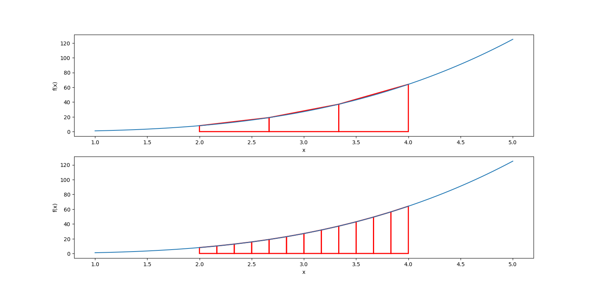

---
contents:
  - "Algorithmes de calcul numérique"
reading_time: "60 minutes"
ai_image: "../../assets/images/ia/IA_NIA.png"
report_url: "https://forms.office.com/r/ccF1FGKW25"
summary: "Décrit le fonctionnement des méthodes numériques, des notions d'itération, de convergence, de pas et d'erreur."
---

L'informatique permet d'effectuer une multitude de calculs et de simulations numériques qui donnent une solution appelée numérique. À la différence des solutions analytiques, les solutions numériques sont souvent des approximations avec une erreur (que l'on peut rendre aussi petite que souhaité), mais permettent d'approximer tous les problèmes calculables (oui, il existe des fonctions non calculables...). Les solutions analytiques sont exactes, mais demandent beaucoup de travail humain pour être calculées. Dans de nombreuses circonstances, on peut traduire un problème sous forme d'algorithme et y trouver une solution numérique, sans pour autant être en mesure de le résoudre analytiquement.

Habituellement les algorithmes numériques donnent une suite ${x_n}$ de points qui convergent (s'approchent) vers une limite donnée, pour des $n$ suffisamment grands. Vous avez sûrement étudié ce concept de limite et convergence dans les cours de calcul différentiel et intégral.

## La convergence numérique et analytique

La convergence d'une suite de points ${x_n}$ vers une limite $L$ permet d'obtenir le résultat d'une méthode de calcul numérique. Nous verrons l'effet des étapes de calcul dans les prochaines sections. Prenons l'exemple du calcul de la valeur de $\pi$. On peut utiliser la suite de [Madhava-Leibniz](https://fr.wikipedia.org/wiki/Formule_de_Leibniz_pour_%CF%80) pour y arriver.

$$ 
\frac{\pi}{4} = \sum_{k=0}^{\infty}\frac{(-1)^k}{2x+1} = 1 - \frac{1}{3} + \frac{1}{5} - \frac{1}{7} + \frac{1}{9} + \cdots
$$

!!! tips "Pas super efficace"

    Cette méthode n'est pas très efficace, mais est simple à comprendre. Pour une méthode plus efficace, vous pouvez utiliser la [formule de Ramanujan](https://fr.wikipedia.org/wiki/Approximation_de_%CF%80)

Voici la valeur calculée pour différentes valeurs de k


|k|Approximation de $\pi$|
|:--|:--|
|0|4.000000|
|1|2.666666|
|2|3.466666|
|5|2.976046|
|10|3.232316|
|100|3.151493|
|1 000|3.142592|
|2 500|3.141992|
|10 000|3.141693|
|100 000|3.141603|
|1 000 000|3.141594|


Dans cet exemple, on peut voir que les décimales de $\pi$ sont de plus en plus précises selon la valeur de $k$.

!!! info "Suite de Cauchy"
    Une suite est dite de Cauchy s'il existe une valeur à partir de laquelle la différence en valeur absolue entre deux termes consécutifs forme une suite strictement décroissante.

    D'un point de vue analytique, être de Cauchy est nécessaire, mais non suffisant pour conclure à une convergence. Dans le cas numérique, dès qu'une suite est de Cauchy, nous risquons d'observer ou de conclure à un résultat de convergence numérique. Cependant, il faut rester prudent, car être de Cauchy n'indique pas que la suite est convergente.

## Les itérations et les erreurs

Dans le cas d'un algorithme de calcul numérique, on s'intéresse à la notion d'erreur afin de déterminer le niveau de précision atteint. Par exemple, voici quelques valeurs de l'approximation de $\pi$ avec leur valeur d'erreur.


|k|Approximation de $\pi$|Erreur (arrondie à 6 chiffres)|Nombre de chiffres précis|
|:--|:--|:--|:--|
|0|4.000000|-0.588407|0|
|1|2.666666|0.474927|0|
|10|3.232316|-0.090723|1|
|100|3.151493|-0.009900|2|
|1 000|3.142592|-0.000999|3|
|10 000|3.141693|-0.000100|3|
|100 000|3.141603|-0.000010|4|
|1 000 000|3.141594|-0.000001|5|


L'erreur est calculée en soustrayant la valeur approximée à la valeur réelle ($valeur réelle - valeur approximée$). On peut généralement travailler avec la valeur absolue de cette erreur comme c'est sa grandeur qui est intéressante et non son signe. 

### Efficacité des calculs

Certains algorithmes sont plus efficaces que d'autres pour parvenir au calcul. Par exemple, l'algorithme d'Héron pour la racine carrée prend la forme de la suite suivante pour la racine de $a$ :

$$
x_{k+1} = \frac{x_{k} + \frac{a}{x_k}}{2}
$$

L'efficacité de l'algorithme dépend du terme $x_0 > 0$ choisi. Plus il est près de $a$, plus efficace sera l'algorithme.


**Approximation de $\sqrt{101}$**

|k|Approximation avec $x_0 = 1$|Erreur (arrondie à 4 chiffres)|Approximation avec $x_0 = 10$|Erreur (arrondie à 4 chiffres)|
|:--|:--|:--|:--|:--|
| 1       | 51         | 40,9501    | 10,05   | 0,0001     |
| 2       | 26,4901961 | 16,4403    | 10,0499 | 7,6966E-10 |
| 3       | 15,1514637 | 5,1016     | 10,0499 | 0          |
| 4       | 10,9087432 | 0,8589     | 10,0499 | 0          |
| 5       | 10,0836858 | 0,0338     | 10,0499 | 0          |
| 6       | 10,0499323 | 5,6682E-05 | 10,0499 | 0          |
| 7       | 10,0498756 | 1,5985E-10 | 10,0499 | 0          |


### Les erreurs de la machine et les limites des ordinateurs

Les ordinateurs peuvent calculer un nombre maximal de décimales, ce qui cause une limitation dans la précision des calculs et l'accumulation d'[erreurs arithmétiques](https://programmation-en-sciences.github.io/bases-de-programmation/types-numeriques-variables-constantes/#le-cas-des-nombres-a-virgule). 

Donc, le 0 qui apparaît dans l'exemple sur les racines n'est pas un réel 0, car il y a une infinité de décimales au développement numérique de la racine de 101. C'est simplement que le programme utilisé ne considère pas assez de décimales pour remarquer une erreur numérique.

## Les pas de calcul

Certains algorithmes numériques calculent la valeur d'une fonction sur un intervalle donné. Dans ces cas, on n'étudie pas le nombre d'itérations, mais plutôt une valeur appelée «&nbsp;pas&nbsp;» qui permet de subdiviser l'intervalle en plus petites zones. Plus le pas est petit, plus le calcul est précis, mais plus il faut d'itérations. Un exemple d'utilisation du pas est dans l'exercice 3 de la révision avec le MRUA.

Un exemple d'utilisation du pas est dans le calcul d'intégrales numériques, comme avec la méthode des trapèzes. Soit une fonction $f(x)$ et un intervalle $[a, b]$ sur lequel $f$ est continue, on cherche à calculer :

$$
\int_{a}^{b}f(x)dx
$$

Par exemple, cherchons l'intégrale de $f(x) = x^3$ pour l'intervalle [2, 4] en connaissance f(0) = 0. L'idée est de recouvrir l'intervalle à intégrer de trapèzes pour approximer l'intégrale.


/// caption
Approximation avec 3 et 12 trapèzes
///

L'algorithme numérique consiste simplement à additionner la valeur de l'aire de chaque trapèze. On note $h$ le pas de l'algorithme. L'aire du trapèze est alors donnée par :

$$
A = \frac{h(f(x) + f(x+h))}{2} = \frac{h(x^3 + (x+h)^3)}{2}
$$

|Nombre de trapèze|Valeur de $h$|Valeur approximée|Erreur|
|:--|:--|:--|:--|
|1|2|72|12|
|3|0.66667|61.33333|1.33333|
|12|0.16667|60.08333|0.08333|
|20|0.1|60.03|0.03|
|100|0.01|60.0012|0.0012|


```python title="Implémentation de la méthode des trapèzes" linenums="1"
def f(x):
    return x**3

def methode_trapeze(nb_trapezes, a, b):
    h = (b-a) / nb_trapezes
    integrale = 0

    for i in range(nb_trapezes):
        x_i = a + i * h
        x_i_plus_1 = x_i + h
        integrale += 0.5 * h * (f(x_i) + f(x_i_plus_1))

    return integrale 

# Pour l'affichage
print(methode_trapeze(12, 2, 4))
```

## Exercice

1. Faites le programme qui permet de calculer la valeur de $\pi$. Approximez $\pi$ en utilisant 100 000 itérations.
2. Calculez la racine, avec la formule d'Héron, de 6247 en utilisant 50 comme valeur initiale.
3. Pour les itérations entre 1 et 5, calculez l'erreur de la méthode avec 4 décimales de précision.
4. Le ratio entre deux termes de la suite de Fibonacci approxime le nombre d'or $\phi = \frac{1+\sqrt{5}}{2} \approx 1.618034$. À l'aide de l'exercice 7 de la première série d'exercices, déterminez combien de termes sont nécessaires pour obtenir une approximation exacte à 4 chiffres de la valeur de $\phi$.

