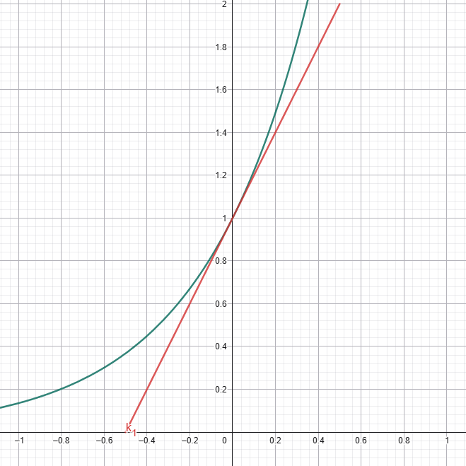
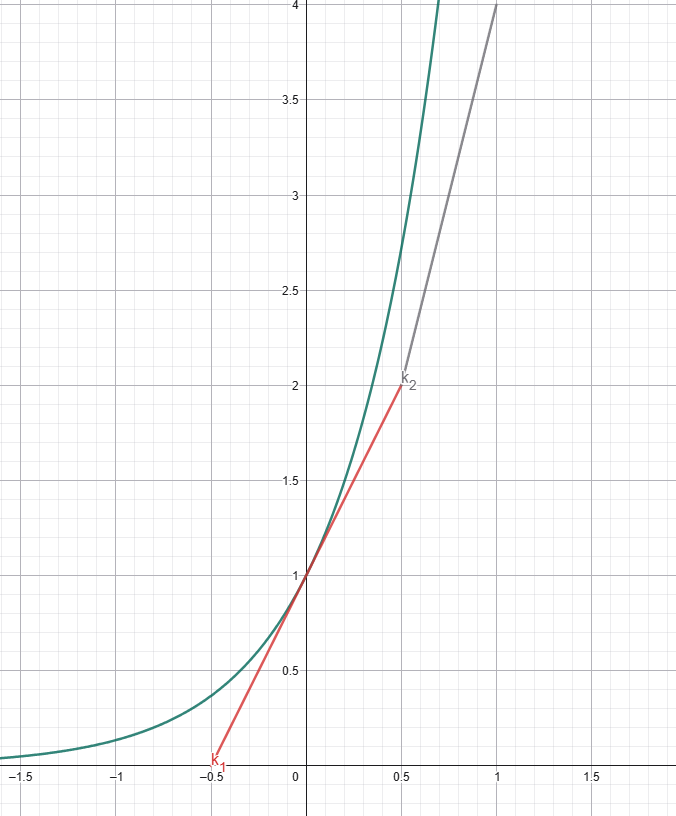
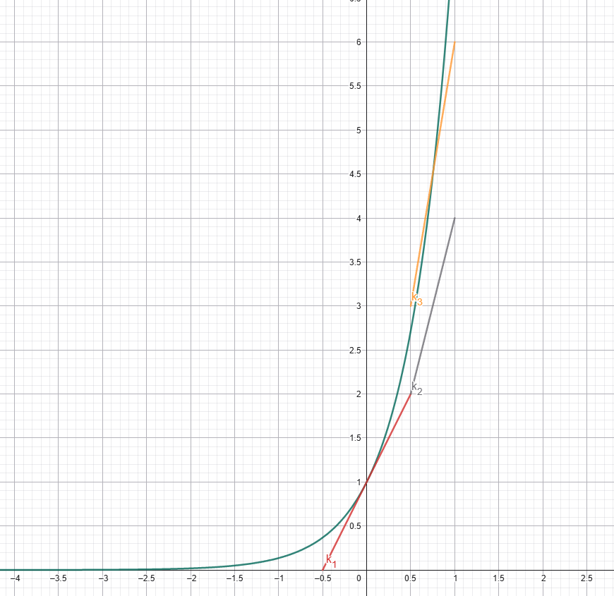
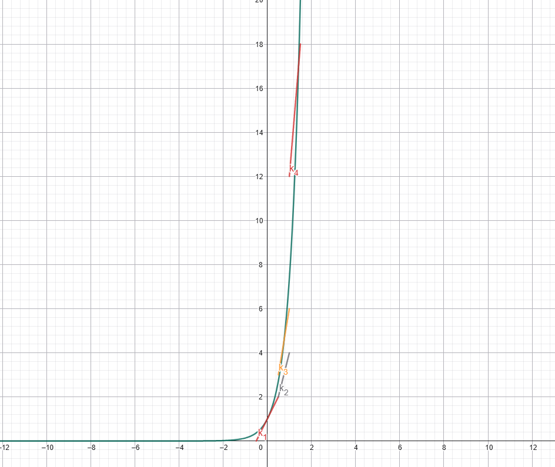

---
contents:
  - "Algorithmes de calcul numérique"
reading_time: "60 minutes"
ai_image: "../../assets/images/ia/IA_NIA.png"
report_url: "https://forms.office.com/r/ccF1FGKW25"
summary: "Présente le fonctionnement de la méthode de Runge-Kutta d'ordre 4 (RK4) pour résoudre une équation différentielle."
---
# Runge-Kutta d'ordre 4

Dans l'estimation par la méthode d'Euler, l'erreur s'accumule rapidement et il est difficile de maintenir un système stable pour de grandes valeurs. La méthode de Runge-Kutta permet de résoudre le même type de problème que la méthode d'Euler, mais utilise une technique différente qui réduit grandement les erreurs.

L'idée de base est la même que celle d'Euler, c'est-à-dire un processus itératif qui utilise l'estimation de la valeur de la fonction par la dérivée.

$$
y'(x) \approx y(x)
$$

lorsque l'on est prêt de $x$. 

## Méthode de Runge-Kutta d'ordre 4

La méthode de Runge-Kutta approche la valeur de la dérivée $y'(x)$ par 4 points. Soit une équation différentielle de la forme : 

$$
\frac{dy}{dx} = f(x, y), \text{ et } y(x_0) = y_0
$$

On cherche à calculer de $y(x_n)$. Il faudra d'abord fixer un pas $h$ tel quel $x_0 + nh = x_n$.

### Première estimation

La première estimation $k_1$ est la valeur de la dérivée en $t_i$. 

{ width=600 }
/// caption
Première étape de l'approximation de RK4
///

$$
k_1 = f(x_i, y_i)
$$

### Seconde estimation

La seconde estimation $k_2$ est la première valeur d'estimation de la dérivée en $t_i + \frac{h}{2}$ (milieu de l'interface). Comme on ne connait pas la valeur de $y_n(t_i + \frac{h}{2})$, on l'estime en utilisant l'information de $k_1$. Il s'agit de l'estimation de la méthode d'Euler.

{ width=600 }
/// caption
Deuxième étape de l'approximation de RK4
///

$$
k_2 = f(x_i + \frac{h}{2}, y_i + k_1\frac{h}{2})
$$

### Troisième estimation

La troisième estimation $k_3$ est la deuxième valeur d'estimation la dérivée en $t_i + \frac{h}{2}$. Comme on ne connait pas la valeur de $y_n(t_i + \frac{h}{2})$, on l'estime en utilisant l'information de $k_2$. Cette seconde estimation vient généralement entourer la fonction de sorte qu'on a une surestimation et une sous-estimation.

{ width=600 }
/// caption
Troisième étape de l'approximation de RK4
///

$$
k_3 = f(x_i + \frac{h}{2}, y_i + k_2\frac{h}{2})
$$

### Quatrième estimation

La quatrième estimation $k_4$ est l'estimation la dérivée à la fin de l'intervalle $t_i + h$. Comme on ne connait pas la valeur de $y_n(t_i + h)$, on l'estime en utilisant l'information de $k_3$. Cette estimation repose sur le dernier point, alors que la première estimation ($k_1$) repose sur le premier point.  

{ width=600 }
/// caption
Quatrième étape de l'approximation de RK4
///

$$
k_4 = f(x_i + h, y_i + h k_3)
$$

### Caluler l'estimation

$$
y_{i+1} = y_n + \frac{h}{6} (k_1 + 2k_2 + 2k_3 + k_4)
$$

## Résumé des équations des estimations

$$
\begin{align*}
k_1 &= f(x_i, y_i) \\
k_2 &= f(x_i + \frac{h}{2}, y_i + k_1\frac{h}{2}) \\
k_3 &= f(x_i + \frac{h}{2}, y_i + k_2\frac{h}{2}) \\
k_4 &= f(x_i + h, y_i + h k_3) \\
y_{i+1} &= y_n + \frac{h}{6} (k_1 + 2k_2 + 2k_3 + k_4)
\end{align*}
$$

## Exemple numérique

Prenons le système suivant

$$
\frac{dy}{dx}=2y,\ y(0) = 1
$$

alors $f(x,y) = 2y$ et utilison $h=1$ pour calculer $y(2)$.

### Itération 1

$$
\begin{align*}
k_1 &= f(x_0, y_0) = 2y_0 = 2\\
k_2 &= f(x_0 + \frac{h}{2}, y_0 + k_1\frac{h}{2}) = f(0.5, 1 + 2 \times  0.5) = f(0.5, 2) = 2 \times 2 = 4\\
k_3 &= f(x_0 + \frac{h}{2}, y_0 + k_2\frac{h}{2}) = f(0.5, 1 + 4 * 0.5) = f(0.5, 3) = 2 \times 3 = 6\\
k_4 &= f(x_0 + h, y_0 + h k_3) = f(1, 1 + 1 * 6) = f(1, 7) = 2 \times 7 = 14\\
y_{1} &= y_0 + \frac{h}{6} (k_1 + 2k_2 + 2k_3 + k_4) = 1 + \frac{1}{6} (2 + 2 \times 4 + 2 \times 6 + 14) = 7
\end{align*}
$$ 

### Itération 2

$$
\begin{align*}
k_1 &= f(x_1, y_1) = 2y_1 = 14\\
k_2 &= f(x_1 + \frac{h}{2}, y_1 + k_1\frac{h}{2}) = f(1.5, 7 + 14 \times 0.5) = f(0.5, 14) = 2 \times 14 = 28\\
k_3 &= f(x_1 + \frac{h}{2}, y_1 + k_2\frac{h}{2}) = f(1.5, 7 + 28 * 0.5) = f(0.5, 21) = 2 \times 21 = 42\\
k_4 &= f(x_1 + h, y_1 + h k_3) = f(1, 7 + 1 * 42) = f(1, 49) = 2 \times 49 = 98\\
y_{2} &= y_1 + \frac{h}{6} (k_1 + 2k_2 + 2k_3 + k_4) = 7 + \frac{1}{6} (14 + 2 \times 28 + 2 \times 42 + 98) = 49
\end{align*}
$$ 

## Exercice

À l'aide d'un programme Python réalisé les estimations suivantes :

1. $\frac{dy}{dx} = 2y$ avec $y(0) = 1$ comme condition initiale. Trouvez la valeur de $y(1)$ avec un pas de 0.5.
2. $\frac{dy}{dx} = 2y$ avec $y(0) = 1$ comme condition initiale. Trouvez la valeur de $y(1)$ avec un pas de 0.01.
3. $y'(x) = 4y(x) + 2$ avec $y(0) = 2$ comme condition initiale. Trouvez la valeur de $y(1)$ avec un pas de 0.01.
4. Résolver le problème  $y'(x) = x \times y(x)$ avec $y(0) = 1$ comme condition initiale. Trouvez la valeur de $y(1)$ avec un pas de 0.01.