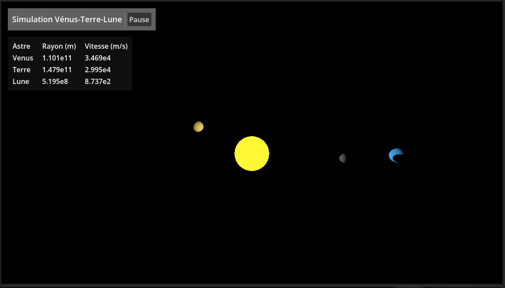

---
contents:
  - "Utilisation d'un moteur de jeu"
reading_time: "45 minutes"
ai_image: "../../assets/images/ia/IA_NIA.png"
report_url: "https://forms.office.com/r/ccF1FGKW25"
summary: "Explique comment créer une interface pour contrôler et afficher des valeurs de la simulation."
---

Dans le cadre des simulations, nous verrons quelques contrôles utilisables directement dans la simulation, mais, pour la plupart, il s'agira d'interaction avec une interface qui permettra de changer les valeurs dans la simulation.

Dans cette section, nous verrons comment créer une scène distincte pour gérer l'interface utilisateur (*user interface* UI) afin d'éviter de surcharger la scène de simulation. Cette même technique peut être utilisée pour gérer des objets complexes en créant plusieurs sous-scènes.

/// caption
Résultat de l'interface créée pour la simulation
///

## Création de la scène du UI

## Les nœuds et contrôles spécifiques au UI

### Les conteneurs

### Les textes

### Les contrôles

## Création de l'interface complète

## Insertion de l'interface dans la scène de simulation

## Structure du projet

Vous pouvez récupérer l'état final de la démonstration ici : [:octicons-mark-github-24: Afficher le projet sur GitHub](https://github.com/simulations-astrophysique/orbite-ui).
