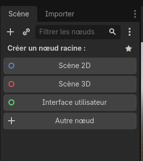
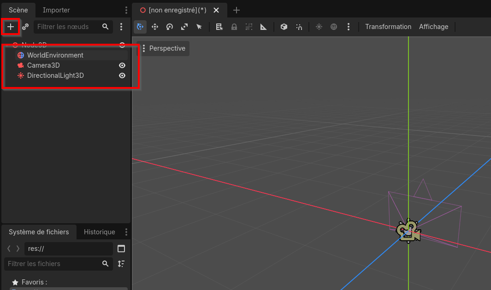
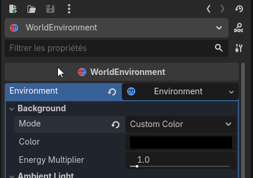
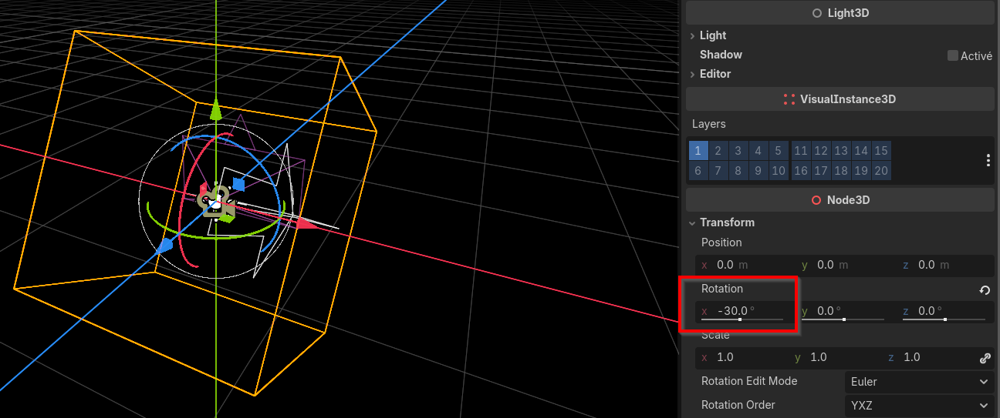
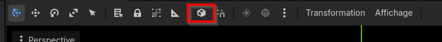

---
contents:
  - "Utilisation d'un moteur de jeu"
reading_time: "30 minutes"
ai_image: "../../assets/images/ia/IA_NIA.png"
report_url: "https://forms.office.com/r/ccF1FGKW25"
summary: "Explique comment créer un nouvelle scène, la configurer et ajoute les objets nécessaires pour observer la simultation."
---

Dans les prochaines pages, nous explorerons la création d'une simulation de Vénus, de la Terre et de la Lune en 5 étapes :

1. Création de la scène;
2. Mouvement analytique de Vénus;
3. Inclusion de la Terre et de la Lune;
3. Mise à l'échelle du système;
4. Mouvement simulé (Euler) des astres.

## Initialisation de la scène

Une scène doit minimalement comporter les éléments suivants :

1. Une racine;
2. Un environnement;
3. Une caméra;
4. Une lumière directionnelle.

Dans la scène, la racine correspond à un `Scène 3D`. On va donc utiliser cette option pour créer le nœud racine.

/// caption
Choix du noeud racine d'une nouvelle scène
///

Une fois ce nœud créé, on va ajouter les 3 nœuds suivants avec le bouton + :

1. WorldEnvironment : contient les données globales de l'environnement.
2. Camera3D : représente le point de vue présenté
3. DirectionalLight3D : gère l'éclairage de la scène.

!!! info "Le nœud sélectionné"

    Lorsque vous appuyez sur +, le noeud sélectionné devient le parent du noeud que vous ajoutez. Vous pouvez remarquer le noeud sélectionné, car il a un arrière-plan coloré.

{ width=600 }
/// caption
Création des noeuds de base d'une scène
///

### WorldEnvironment

L'environnement définit certains paramètres globaux, comme le ciel ou certains effets visuels. Dans le cadre de la simulation, nous allons simplement assigner une couleur d'arrière-plan noire à toute notre scène. En sélectionnant le nœud `WorldEnvironment`, vous verrez l'inspecteur suivant s'afficher à droite.

Sélectionnez **Environment** dans la liste déroulante à côté de l'étiquette **Environment**, puis cliquez sur l'item sélectionné. Dans le panneau **Environment** qui s'affiche, dans le bloc **Background**, changez le **Mode** pour **Custom Color** et sélectionnez la couleur noire.

/// caption
Configuration de l'environnement de la scène
///

### DirectionalLight3D

La lumière directionnelle génère une source lumineuse qui illumine tous les objets de la scène selon une certaine direction. Elle est censée simuler l'effet d'un éclairage comme celui du Soleil. La position de l'objet importe peu, seulement sa rotation qui détermine l'orientation de la lumière.

Lorsqu'on sélectionne le nœud, des *gizmos* pour le manipuler apparaissent. Les flèches permettent de gérer les translations tandis que les cercles donnent l'angle de rotation. Dans l'inspecteur, sous la rubrique **Node3D**, il est possible d'ajouter les valeurs de **Transform** pour entrer manuellement les valeurs à utiliser. Dans le cas de la simulation, une lumière à -30° de rotation autour de l'axe des X sera adéquate.

/// caption
Configuration de la lumière directionnelle
///

### Camera3D

Les contrôles pour positionner la caméra sont les mêmes. Il est possible d'avoir un aperçu de l'affichage de la caméra (qui, pour l'instant, regarde une scène vide...). 

!!! info "Coordonnées locales et globales"

    Par défaut, les axes affichent les coordonnées globales, soit le système de référence par rapport à l'origine de la scène et les axes alignés dans le monde.

    Le mode local permet d'avoir les informations par rapport à l'origine du parent et d'avoir les *gizmos* de translation qui suivent la rotation, cela peut aider l'alignement des objets. La touche T permet de basculer de l'un à l'autre ou le bouton suivant dans la barre d'outils.

/// caption
Utilisation des coordonnées globales ou locales
///
