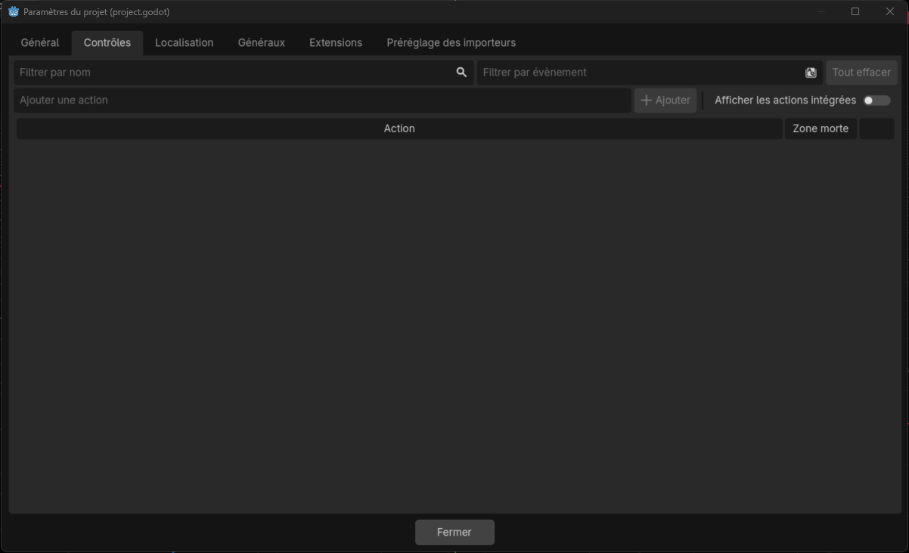
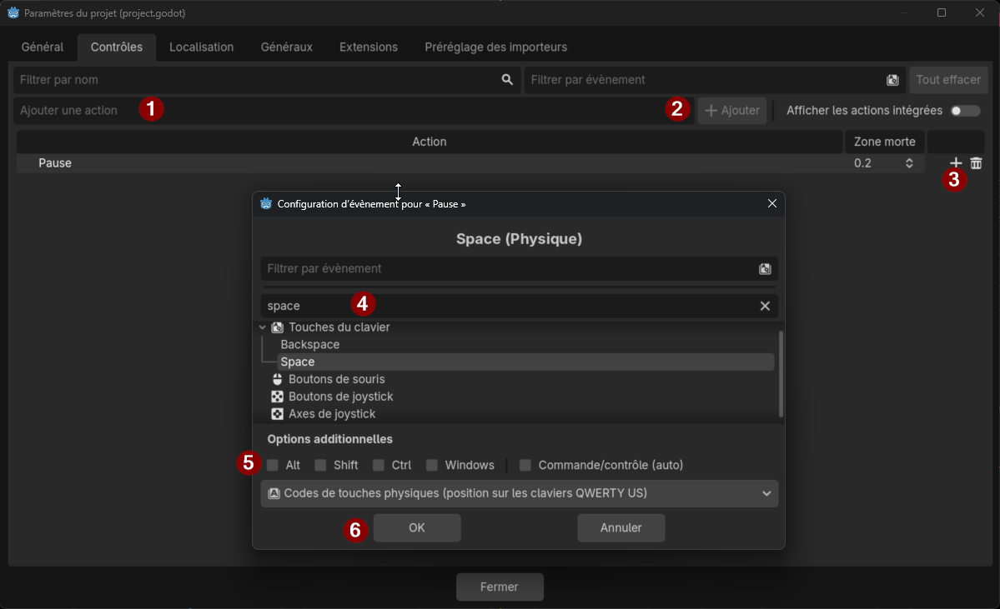
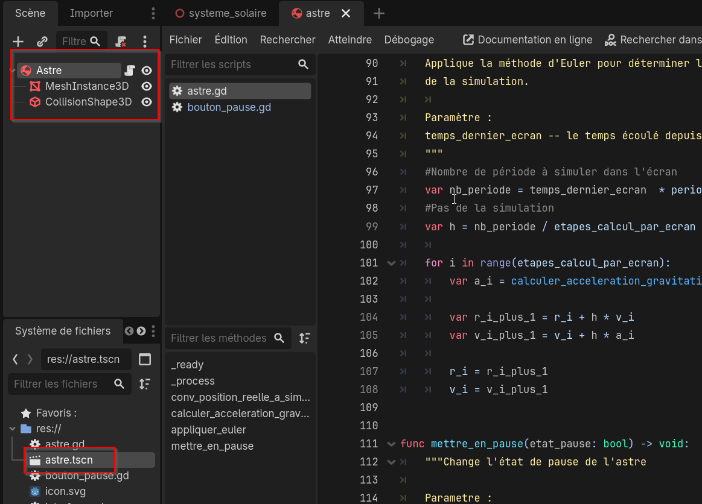
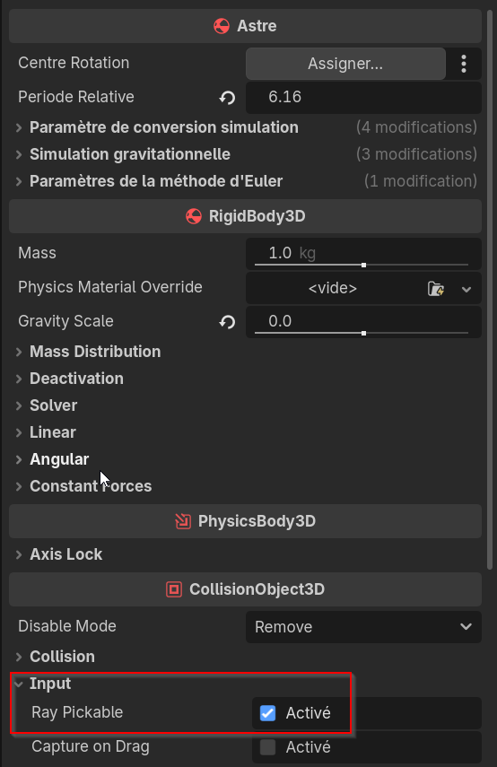
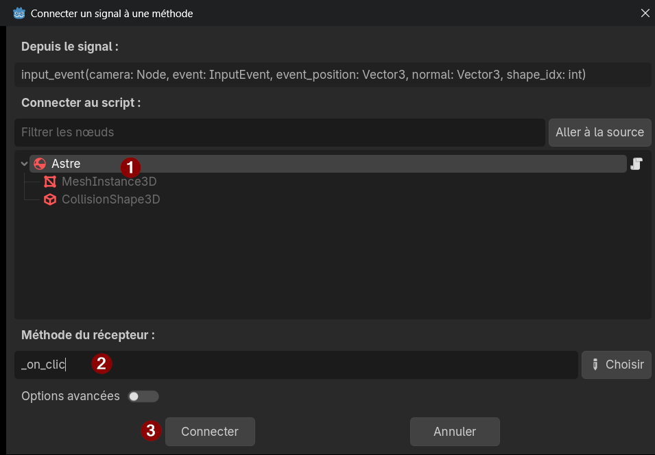
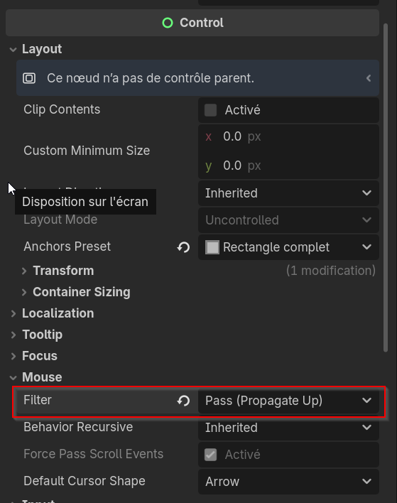

---
contents:
  - "Utilisation d'un moteur de jeu"
reading_time: "45 minutes"
ai_image: "../../assets/images/ia/IA_NIA.png"
report_url: "https://forms.office.com/r/ccF1FGKW25"
summary: "Explique comment utiliser les contrôles de l'ordinateur pour interagir avec la simulation."
---

Dans ce module, nous verrons 3 façons d'interagir avec le monde de simulation : 

- Touches du clavier;
- Clic sur les objets; et 
- Saisie de texte dans les contrôles de l'interface.

## Touches du clavier

On peut configurer les touches pour agir comme raccourci lors de l'exécution d'un système. On associe généralement les flèches ou les touches WASD par exemple pour un déplacement.

On va ajouter la touche d'espace pour contrôler aussi la pause ou la reprise de la simulation. Pour commencer, il faut accéder à la fenêtre des contrôles situés dans le menu **Projet** > **Paramètres du projet** > **Contrôles**. Les contrôles sont gérés par des «&nbsp;actions&nbsp;» qui peuvent être récupérées dans les scripts.

{ width="750" }
/// caption
Permet d'ajouter un contrôle dans la simulation
///

Pour ajouter le contrôle, il faut d'abord lui donner un nom, puis sélectionner la touche à laquelle ce contrôle est lié.

{ width="750" }
/// caption
Permet d'ajouter un contrôle dans la simulation
///

1. Entrez le nom de l'action souhaitée (ici «&nbsp;Pause&nbsp;»);
2. Appuyez sur **Ajouter** pour créer l'action;
3. Appuyez sur le **+** au bout de la ligne pour associer un contrôle à cette action;
4. Recherchez le nom de la touche (tous les noms sont en anglais);
5. Au besoin, ajoutez une touche modificatrice; et
6. Appuyez sur **Ok** pour compléter l'ajout.

Ensuite, du côté du code, nous irons récupérer cette action dans le script **bouton_pause** afin de mettre à jour correctement la simulation. L'idée est d'écouter continuellement, dans la fonction `__process` si l'action a été réalisée.

```gdscript title="bouton_pause.gd" linenums="1"
# Mettre en pause lorsque l'action Pause est réalisée 
func _process(_delta: float) -> void:
	if Input.is_action_just_pressed("Pause"):
		changer_etat_pause()
```

!!! info "is_action_just_pressed"

    Cette fonction retourne `#!gdscript true` seulement la frame où l'action est accomplie. Cela permet d'obtenir une action qui se produit qu'une seule fois. La fonction `#!gdscript is_action_pressed` retourne `#!gdscript true` toutes les frames où l'action est accomplie. 

## Utiliser la souris pour cliquer sur un objet

Pour rendre les objets cliquables, il est nécessaire de faire des modifications à la structure de la scène et d'exploiter les signaux et de définir une action.

### Réorganiser la scène

La première chose que nous devrons faire est de *réorganiser la scène*. En effet, habituellement dans Godot, une scène est une unité très petite. Le problème dans notre structure actuelle est que chaque astre est défini dans la même scène, alors qu'on devrait définir qu'un seul astre et réutiliser la scène. Le plus simple est de glisser-déposer un des astres dans la zone **Système de fichiers**, puis de supprimer les 3 astres de la scène.

{ width="500" }
/// caption
Création de la scène astre
///

Après, on peut ajouter 1 scène enfant, Vénus avec la commande **Instancier une scène enfant** et reconfigurer les paramètres dans l'inspecteur, ainsi que réassigner les contrôles de l'interface. Pour éviter les problèmes, on peut affecter Vénus à chacun des astres (on règlera ce problème plus tard). Normalement, si on lance la simulation, le comportement de Vénus devrait être le même qu'avant la modification.

!!! tips "Faire de petites scènes"

    À partir de maintenant, tout sera décomposé en plus petites scènes et il est attendu que vous utilisez ces techniques dans votre travail. 

### Exploiter les signaux

!!! warning "Position dans le projet"

    Assurez-vous d'être dans la scène **Astre** pour faire ces manipulations.

La technique pour récupérer le clic est différente et demande de passer par les signaux. D'abord, on doit s'assurer que l'objet peut recevoir une collision. D'abord les objets doivent avoir un `Rigidbody3D` et un `CollisionShape3D` pour réagir aux collisions. Ensuite, le paramètre **Ray Pickable** doit être activé.

Ensuite, dans l'interface Signaux (à côté de l’Inspecteur), il faudra sélectionner **input_event** avec un double clic. Cela va permettre d'associer ce signal à une fonction dans le code.

{ width="400" }
/// caption
Création sélection du signal à connecter
///

{ width="600" }
/// caption
Connexion du signal à une fonction
///

1. Assurez-vous que l'objet qui doit recevoir le signal soit bien sélectionné;
2. Le récepteur est le nom de la fonction qui sera appelée lorsque le signal est lancé (renommé en *_on_clic* dans l'exemple); et
3. Une fois la configuration complétée, il faut cliquer sur **Connecter**.

La fonction suivante est ajoutée au script Astre. On peut ensuite changer la fonction pour réagir au clic.

```gdscript title="Astre" linenums="1"
func _on_clic(camera: Node, event: InputEvent, event_position: Vector3,
     normal: Vector3, shape_idx: int) -> void:
	pass # Replace with function body.
```

### Laisser les événements traverser le UI

Si vous utilisez le code dans l'état actuel, vous ne serez pas capable de cliquer sur Vénus. Il est nécessaire d'indiquer au nœud de l'interface de laisser passer les événements. Pour ce faire, il faut changer la façon dont l'interface traite les événements de la souris.

En sélectionnant le nœud de l'interface, dans l'inspecteur **Control** > **Mouse** > **Filter**, il faut changer la valeur pour **Pass (Propagate Up)**.

{ width="500" }
/// caption
Permet aux événements de clic de traverser l'interface
///

### Définir la condition pour récupérer le clic gauche

Pour récupérer uniquement le clic gauche de la souris, il faut filtrer tous les événements reçus avec la condition suivante. Elle permet de recevoir les événements de type *MouseButton*, lorsque le bouton impliqué est celui de gauche et quand il est appuyé (*pressed*), et non lorsqu'il est relâché.

```gdscript title="Astre" linenums="1"
func _on_clic(camera: Node, event: InputEvent, event_position: Vector3,
     normal: Vector3, shape_idx: int) -> void:
	if event is InputEventMouseButton and event.button_index == MOUSE_BUTTON_LEFT and event.pressed:
		print("Clic sur " + name)
```