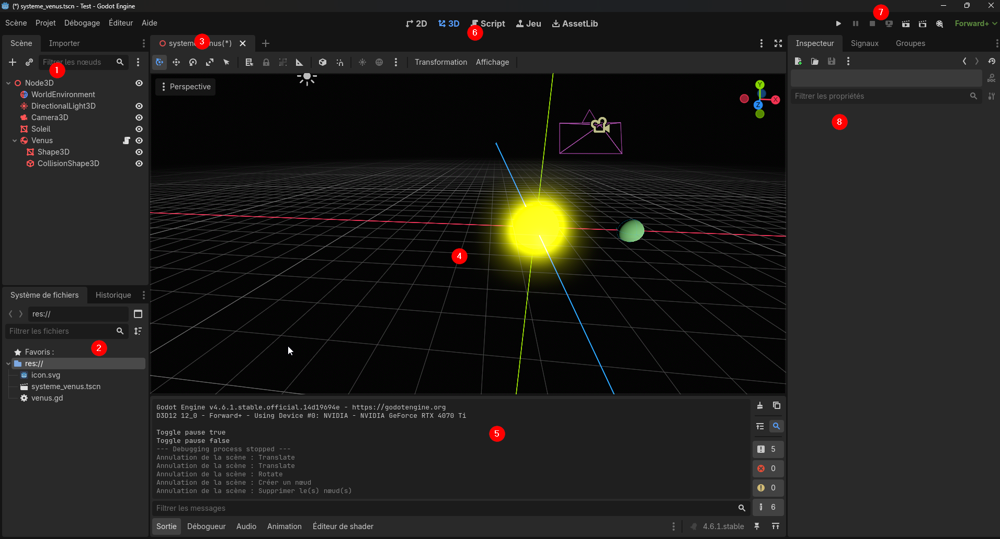

---
contents:
  - "Utilisation d'un moteur de jeu"
reading_time: "20 minutes"
ai_image: "../../assets/images/ia/IA_NIA.png"
report_url: "https://forms.office.com/r/ccF1FGKW25"
summary: "Présente l'interface principale de Godot et ses concepts de base."
---

L'interface du moteur Godot se répartit en plusieurs sections. La présente page donne un aperçu des principales sections.

/// caption
Sections de l'interface de Godot
///

1. Vue des différents objets de la scène;
2. Fichiers du projet;
3. Onglet actif et barre d'outils;
4. Contenu de l'onglet actif - ici on a la vue 3D;
5. Console de Godot où les messages d'erreurs s'affichent;
6. Sélectionne la vue active. On travaille principalement dans 3D et Script;
7. Contrôles pour lancer le jeu;
8. Vue de l'inspecteur qui affiche les propriétés du nœud manipulé.

## Concepts de Godot

Dans Godot, chaque élément d'une scène est un nœud (`Node`). Comme nous ferons des modélisations en 3 dimensions, nous utiliserons des `Node3D` qui sont un type de nœud (donc ont les mêmes propriétés que les `Node`) et ajoute des informations propres au 3D. Ce qui est affiché dans Godot est une **scène**. Chaque scène possède une racine qui est un `Scène 3D`. Tous les autres `Node` doivent être enfant d'un `Node` (donc placé en dessous dans la hiérarchie).

Plusieurs types de `Node` sont disponibles dans Godot, nous les verrons au fur et à mesure que nous les utiliserons. Des comportements peuvent être ajoutés aux `Node` avec des scripts dans le langage GDScript, fortement inspiré de Python. 

Chaque `Node` affiche ses propriétés dans l'inspecteur lorsqu'il est sélectionné. C'est le chemin le plus usuel pour modifier les propriétés d'un `Node`.