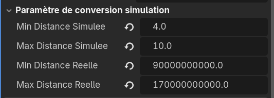

---
contents:
  - "Utilisation d'un moteur de jeu"
  - "Concevoir des algorithmes pour le calcul numérique"
reading_time: "60 minutes"
ai_image: "../../assets/images/ia/IA_NIA.png"
report_url: "https://forms.office.com/r/ccF1FGKW25"
summary: "Décrit des techniques de mise à l'échelle, du temps, de l'espace et des masses pour la simulation."
---

Le prochain défi dans l'utilisation d'un outil de simulation est de faire le lien entre les valeurs du monde réel et celle de la simulation. Afin de bien visualiser les éléments de la simulation, il faut à la fois déformer l'espace et le temps pour observer le phénomène, mais le faire de façon à ne pas déformer ou dénaturer les phénomènes qu'on observe. En astrophysique, généralement, les échelles de temps, de volume et les distances forcent des déformations majeures.

**Le temps**

Il y a deux façons de gérer la simulation en temps, selon l'objectif. 

- Si l'on cherche à observer un phénomène (comme une synchronisation d'orbite), ceux-ci sont généralement de l'ordre de millions ou milliards d'années. Il faut compresser l'échelle de temps ou augmenter les forces appliquées de façon à obtenir une visualisation en un temps raisonnable du phénomène. On applique une déformation du temps. On peut l'appliquer de façon logarithmique, car souvent, la magnitude du phénomène ralentit avec le temps. En effet, la magnitude du phénomène s'observe  souvent grâce au gradient des forces qui diminue lorsque la simulation s'approche du point de minimisation des forces en présence. 
- Si l'on cherche à observer un système (comme les orbites du système solaire), les échelles varient fortement, mais l'on peut généralement préserver les ratios entre les objets. On parle alors d'un temps relatif ou d'une période de rotation relative. Par exemple, la Lune prend 27.3 jours terrestres à accomplir une révolution de la Terre. On peut donc exprimer la période de révolution de la Lune comme une fraction de celle terrestre. Généralement, cette solution permet d'éviter les déformations entre les éléments ou les exprime selon une formule (logarithme, racine...).

**Les volumes**

Les volumes s'expriment dans les mêmes unités que les distances, ce qui pose un problème, car les volumes sont beaucoup plus petits que les distances. Si l'on préserve les deux, on aurait une observation avec des objets trop petits pour les voir ou trop distants les uns des autres pour observer quelque chose d'intéressant. De plus, la variabilité entre les corps est importante, c'est pourquoi on utilise généralement une échelle logarithmique distincte de celle pour les distances entre les objets.

**Les distances**

Les distances en astronomie sont ... astronomiquement grandes (bad dum tss !). Il faut donc les rétrécir afin de pouvoir observer les phénomènes. Il peut être tentant d'utiliser une échelle logarithmique, mais elle ne se prête pas à toutes les situations. Par exemple, si l'on modélise le système solaire en utilisant une échelle logarithmique simple, les 4 premières planètes sont concentrées dans 17% de l'espace (ce qui est mieux que les 3.8 % de l'espace réel), mais cela peut amener une difficulté de visualiser ce qui se produit. Encore là, la déformation n'est pas extrême, car toutes les planètes ont une distance dans le même ordre des grandeurs. Si l'on ajoute les lunes, par contre, celles-ci sont beaucoup trop proches des planètes pour que l'on observe quoi que ce soit d'intéressant en utilisant la même échelle.

**Les masses, les forces et les vitesses**

Les autres données physiques souvent utilisées n'ont pas besoin d'être mises à l'échelle spécifiquement. Par exemple, pour les masses, elles n'ont pas de représentation dans la simulation. Les forces dépendent des masses et des accélérations, qui dépendent elles-mêmes  du temps et des distances déjà mises à l'échelle. 

## La mise à l'échelle du système

Pour mettre à l'échelle le système Soleil-Vénus-Terre-Lune de l'exemple, nous utiliserons les valeurs suivantes :

Données des corps utilisés dans la simulation

|Corps|Masse|Rayon moyen de l'orbite|Période de révolution|Rayon moyen|
|:--|:--|:--|:--|:--|
|Soleil|$1,988 \times 10^{30}$ kg |-|-|$6,963 \times 10^{8}$ m|
|Vénus|$4,868 \times 10^{24}$ kg| $1,0815 \times 10^{11}$ m|225 jours terrestres|$6,052 \times 10^{6}$ m|
|Terre|$5,972 \times 10^{24}$ kg| $1,469 \times 10^{11}$ m|365 jours terrestres|$6,378 \times 10^{6}$ m|
|Lune|$7,35 \times 10^{22}$ kg|$3,84 \times 10^{8}$ m|27.3 jours terrestres|$1,737 \times 10^{6}$ m|

## Les tailles

L'échelle des tailles varie d'environ $1.7 \times 10^6$ à $7 \times 10^8$. Notre but pour avoir une visualisation adéquate des phénomènes est de ramener cette échelle entre 0.5 et 2 dans Godot.

- **Échelle linéaire** : en appliquant les conversions dans l'échelle linéaire, les 3 corps Vénus, Terre et Lune sont pratiquement de la même taille (entre 0.50 et 0.51).
- **Échelle logarithmique** : en appliquant une échelle logarithmique, puis en appliquant une interpolation linéaire, on obtient une représentation beaucoup plus adéquate des volumes.

Mise à l'échelle des volumes

|Corps|Rayon moyen ($r$)|$\log_{10}(r)$|Ratio|Unité|Ratio réel|
|:--|:--|:--|:--|:--|:--|
|Soleil|$6,963 \times 10^{8}$ m|8,84|1.000|2.0|1.0|
|Vénus|$6,052 \times 10^{6}$ m|6,78|0.208|0.812|0.0087|
|Terre|$6,378 \times 10^{6}$ m|6,80|0.217|0.826|0.0092|
|Lune|$1,737 \times 10^{6}$ m|6,24|0.000|0.5|0.0025|

??? info "Exemple de calculs pour Vénus"

    Le ratio s'obtient en faisant l'interpolation linéaire inverse sur l'échelle disponible.

    $$
    \begin{align*}
        \text{ratio} &= \frac{\text{valeur} - \text{min}_{\text{echelle}}}{ \text{max}_{\text{echelle}} -  \text{min}_{\text{echelle}}} \\\\
        &= \frac{6.78 - 6.24}{8.84-6.24} \\\\
        &= 0.208
    \end{align*}
    $$

    Puis on fait un interpolation linéaire dans les valeurs qu'on a fixé dans Godot.

    $$
    \begin{align*}
        \text{unité} &= \text{ratio} \times (\text{max}_{\text{echelle}} - \text{min}_{\text{echelle}}) +  \text{min}_{\text{echelle}} \\\\
        &= 0.208(2 - 0.5) + 0.5 \\\\
        &= 0.812
    \end{align*}
    $$

    On applique ensuite la valeur 0.812 comme valeur d'échelle dans Godot

## Le temps

Dans le cadre de cet exemple, on utilisera un temps relatif en prenant la période de révolution de la Terre comme référence. Avec le code précédent, il suffit de modifier la variable `periode` par la variable `periode_relative` et y assigner la valeur de la période de rotation relative à celle de la Terre.

Périodes de révolution relative 

|Corps|Période de révolution|Période de révolution relative|
|:--|:--|:--|
|Vénus|225 jours terrestres|0,616|
|Terre|365 jours terrestres|1,000|
|Lune|27,3 jours terrestres|0,075|

## Les distances

Les distances sont plus complexes à mettre à l'échelle, car les valeurs de distance varient dans l'exécution. Il faut donc le faire dans la programmation. De plus, en raison de la différence dans l'échelle du système Soleil-Vénus-Terre et Terre-Lune, il faudra prévoir deux mises à l'échelle distincte.

### Le système Soleil-Vénus-Terre

On voudra ramener l'orbite de Vénus et de la Terre entre les unités 4 et 10 de la simulation. On va devoir aussi prévoir une région pour nos calculs plus grande que celle des orbites analytiques, car, lorsqu'on fera des orbites simulées (prochaine partie), les variations arithmétiques et des orbites pourraient nous faire dévier du chemin parfait.

Comme le rayon de l'orbite moyenne de Vénus est de  $1,0815 \times 10^{11}$ m et celui de la Terre $1,469 \times 10^{11}$ m, on prendra en charge des valeurs entre $9 \times {10}^{10}$ m et $1.7 \times 10^{11}$ m. Ces deux valeurs sont déterminées arbitrairement et pourraient devoir être ajustées.

On utilisera une simple mise à l'échelle linéaire dans l'intervalle $[4;10]$ dans Godot. 


#### Implémentation

Deux fonctions utilitaires viennent nous aider

- **inverse_lerp** : réalise une interpolation linéaire inverse - détermine le ratio où une valeur se situe entre deux bornes
- **lerp** : réalise une interpolation linéaire - détermine une valeur entre deux bornes à partir d'un ratio

Afin de pouvoir utiliser ces fonctions, nous définirons des valeurs seuils. Pour éviter que notre interface devienne désorganisée, nous ferons un groupe de variables.

```gdscript title="Variable pour la mise à l'échelle" linenums="1"
@export_group("Paramètre de conversion simulation")
@export var min_distance_simulee : float
@export var max_distance_simulee : float
@export var min_distance_reelle : float
@export var max_distance_reelle : float
```


/// caption
Groupe des variables de mise à l'échelle dans l'inspecteur de Vénus
///

!!! tips "Écrire de grands nombres"

    Les champs de Godot supportent l'écriture scientifique : vous pouvez écrire simplement `9e10` et Godot fait la conversion.

La fonction `_process` est ensuite modifiée pour inclure une étape de conversion de la position.

```gdscript title="Adaptation de _process" linenums="1"
func _process(delta: float) -> void:
	# Calcule la position réelle
	var position_reelle = Vector3(
		rayon * cos(2 * PI / periode_relative * temps),
		0.0,
		rayon * sin(2 * PI / periode_relative * temps)
	)
	
	# Converti la position
	position = conv_position_reelle_a_simulee(position_reelle)

    #...
```

On remarque qu'on calcule d'abord la position dans une variable temporaire (`position_reelle`), qui contient la position réelle et qu'on appelle une fonction qui fait la conversion vers les unités de la simulation.

!!! warning "Changement du rayon"

    La valeur du rayon doit être modifiée pour prendre la valeur réelle et non en unité de la simulation.

```gdscript title="Conversion de position réelle à simulée" linenums="1"
func conv_position_reelle_a_simulee(position_reelle : Vector3) -> Vector3:
    """Effectue la conversion d'une position réelle à une position de l'espace 
    de la simulation

    Paramètres:
    position_reelle -- la position réelle à convertir

    Retour :
    la position dans le monde de la simulation à utiliser
    """

    var distance_relle = position_reelle.length()
    var ratio_distance = inverse_lerp(min_distance_reelle, max_distance_reelle, 
        distance_relle)
    var facteur_distance_simulee = lerp (min_distance_simulee, max_distance_simulee,
            ratio_distance)

    return position_reelle.normalized() * facteur_distance_simulee
```

On utilise ici la mise à l'échelle des vecteurs, technique qui consiste à changer la longueur d'un vecteur sans en changer la direction. La fonction `length` permet d'obtenir la norme du vecteur. On fait ensuite la mise à l'échelle de la longueur du vecteur. Pour positionner correctement l'objet, on va simplement changer la longueur du vecteur de position réelle pour que ses unités soient dans le monde réel. La fonction `normalized` retourne le vecteur unitaire dans la même direction que le vecteur sur lequel la fonction est appelée.

??? info "Rappel : mise à l'échelle de vecteur"

    Soit $\overrightarrow{u}$ un vecteur et $\ell$ norme souhaitée pour le nouveau vecteur. On obtient un vecteur $\overrightarrow{v}$  dans la direction de $\overrightarrow{u}$ de norme $\ell$ avec la formule :

    $$
    \overrightarrow{v} = \ell \frac{\overrightarrow{u}}{||\overrightarrow{u}||}
    $$

    Autrement dit, on multiplie la norme souhaitée par le vecteur unitaire de $\overrightarrow{u}$.
    
### Exercice : le système Terre-Lune

Mettez à l'échelle la distance de rotation du système Terre-Lune dans la simulation.
