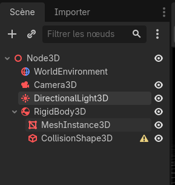
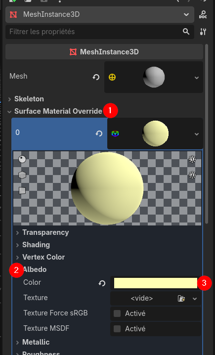
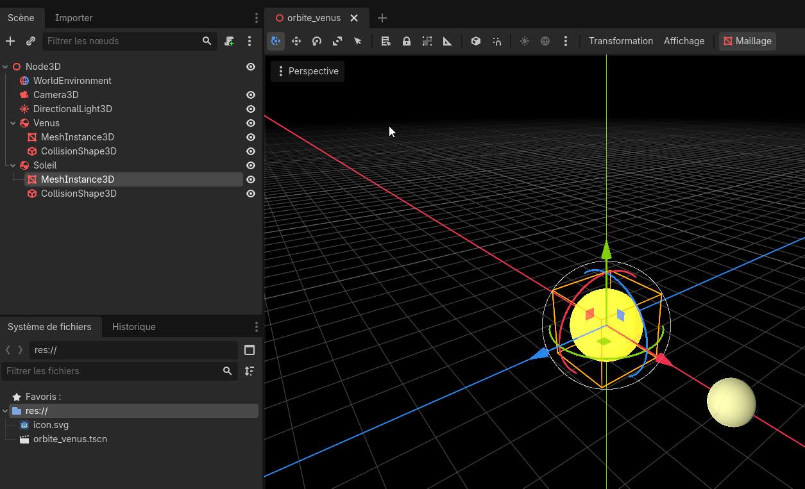
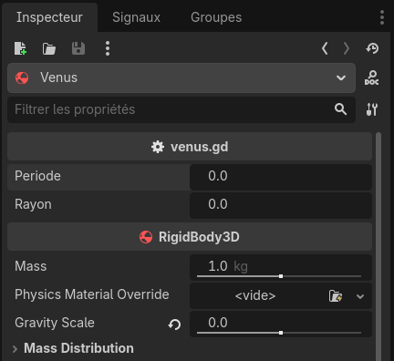

---
contents:
  - "Utilisation d'un moteur de jeu"
reading_time: "30 minutes"
ai_image: "../../assets/images/ia/IA_NIA.png"
report_url: "https://forms.office.com/r/ccF1FGKW25"
summary: "Ajoute les éléments Vénus et Soleil à la scène et cération un script pour gérer la rotation de Vénus de façon analytique."
---

## Création des objets

Avant de coder le mouvement analytique de Vénus, il nous faudra créer ses objets. Le premier à créer est le `RigidBody3D` qui représente un objet qui a des caractéristiques physiques dans le cadre de la simulation. Nous exploiterons peu les éléments physiques du moteur de jeu, mais Godot peut avoir besoin de ce nœud dans ses opérations avec d'autres nœuds qui nous utiliseront. Ensuite, il faut ajouter deux nœuds enfants :

1. `MeshInstance3D` qui est un représente les données d'une forme à afficher;
2. `CollisionShape3D` qui représente une zone de collision. Elle nous sera utile éventuellement pour traiter des éléments interactifs dans la simulation.

Nous renommerons le nœud parent comme `Venus` afin de pouvoir le repérer facilement dans la scène. Simplement cliquez sur le nœud, avec clic droit et renommer ou sélectionner le nœud et appuyer sur F2.


/// caption
Création de Vénus
///

### Configuration du `RigidBody3D`

La seule configuration que nous allons enlever du `RigidBody3D` est l'utilisation de la gravité. Après tout, la simulation est dans l'espace et nous ne voulons pas que les objets tombent. Dans l'inspecteur, trouvez le paramètre **Gravity Scale** et ajustez sa valeur à 0.

!!! info "Désactiver la gravité pour toute la simulation"

    Une alternative à la faire cette manipulation pour chaque objet est de se rendre dans le menu **Projet** > **Paramètres du projet** > **Général** > **Physique** > **3D** et de changer **Gravité par Défaut** pour y mettre 0.

Nous en profiterons aussi pour placer Vénus à sa position initiale, soit en (4; 0; 0). Il est important de manipuler le nœud parent, autrement nous aurons des problèmes plus tard avec le positionnement des objets.

### Configuration du `MeshInstance3D`

Pour le champ **Mesh** dans l'inspecteur du `MeshInstance3D`, nous allons sélectionner le *mesh* de type *Sphere Mesh*. Vous devriez voir une sphère apparaître dans l'écran.

Un mesh définit seulement la géométrie de la forme. Un `Material` définit l'affichage de la forme. Par défaut, un `Material` gris est appliqué sur l'objet afin de le visualiser. Nous allons changer la couleur pour y mettre une couleur verte. 

Dans le champ **Surface Material Override** nous allons cliquez sur *Standard Material 3D*, ce qui crée un nouveau `Material`. En cliquant sur la sphère qui est apparue (1), nous irons dans le sous-menu [*Albedo*](https://fr.wikipedia.org/wiki/Alb%C3%A9do) (2) et changer la **Color** (3) pour une teinte de jaunâtre assimilable à Vénus (rgb : 255, 255, 180).


/// caption
Choix du noeud racine d'une nouvelle scène
///

### Configuration du `CollisionShape3D`

Pour le champ **Shape** dans l'inspecteur du `CollisionShape3D`, nous allons sélectionner la forme de type *Sphere Shape 3D*. Vous devriez voir une sphère bleue apparaître finement autour de Vénus. Il se peut que vous deviez zoomer beaucoup pour la voir.

## Exercice 1

Ajoutez le Soleil au centre de la simulation. Modifiez son paramètre **Scale** dans la section **Transform** pour augmenter sa taille (deux fois plus gros que Vénus). Vous devez faire cette opération sur le `MeshInstance3D` et le `CollisionShape3D`.

Pour les personnes plus avancées, explorer les options du `Material` pour lui donner un aspect brillant.

??? success "Solution" 

    
    /// caption
    Création du Soleil
    ///

## Ajouter un script pour faire tourner Vénus

Godot utilise un langage de programmation qui lui est propre, le GDScript. Toutefois, la syntaxe du GDScript est très proche de celle du Python, donc la plupart des opérations que nous avions l'habitude de faire en Python se feront presque de la même façon avec GDScript.

Donc, nous allons ajouter un script en utilisant clic droit sur le nœud Venus et sélectionner «&nbsp;Attacher un script&nbsp;». On laisse les paramètres par défaut et on clique sur «&nbsp;Charger&nbsp;».

### Structure d'un script

```gd title="Script vide" linenums="1"
extends RigidBody3D


# Called when the node enters the scene tree for the first time.
func _ready() -> void:
	pass # Replace with function body.


# Called every frame. 'delta' is the elapsed time since the previous frame.
func _process(delta: float) -> void:
	pass
```

Dans ce script, la ligne 1 indique que ce script est basé sur le modèle de `RigidBody3D`. Nous verrons plus tard les implications de cette ligne. Ensuite, deux fonctions sont déclarées. En GDScript, on utilise le mot\-clé `func` plutôt que `def` pour définir une fonction. Ces deux fonctions, qui commencent avec un trait de soulignement (*underscore*), sont appelées par la **boucle de jeu**.

!!! info "Boucle de jeu"

    La boucle de jeu s'exécute à chaque écran (*frame*) et appelle certaines fonctions sur tous les noeuds du jeu. Ce sont grâce à ces fonctions que l'on peut mettre à jour l'état des objets de jeu et donner un aspect temps réel à un jeu.

La première fonction `_ready()` est appelée lorsque le nœud est positionné dans la scène pour la première fois. On y fait des opérations d'initialisation des objets dans la scène.

La seconde fonction `_process(delta: float)` est appelée à chaque écran du jeu. Elle permet de mettre à jour l'état d'un objet. Elle accepte un paramètre appelé **delta** qui est de type `float`. Nous verrons l'usage de ce paramètre plus loin.

Au niveau de la syntaxe, on remarque l'ajout de `-> void` après les fonctions. GDScript demande d'indiquer explicitement le type de retour de la fonction. Les deux fonctions retournent `void`, c'est-à-dire rien. On peut aussi remarquer que les fonctions contiennent une seule instruction `pass`. Il est interdit de déclarer des fonctions vides, donc l'utilisation de l'instruction `pass` permet simplement de ne rien faire et continuer l'exécution.

### Orbite de Vénus

Donc, pour afficher l'orbite de Vénus, nous allons utiliser la fonction `_process` pour mettre à jour sa position. Le paramètre *delta* nous indique combien de temps s'est écoulé depuis le dernier écran. Ce paramètre nous permettra donc de faire une mise à l'échelle au temps de la simulation. 

!!! error "Oui, mais en 60 FPS je pourrais simplement diviser par 60"

    Non, même si un jeu s'exécute en 60FPS, le temps de rendu de chaque écran varie. Coder une division par 60 entraînera des erreurs dans l'exécution.

Nous allons déclarer les variables suivantes :

1. Période de rotation de Vénus (periode) : 5 secondes par tour 
2. Distance à l'origine (rayon) : 4 mètres
3. Temps écoulé dans la simulation (temps) : 0 seconde 

Pour déclarer une variable en GDScript, c'est comme en Python, mais il faut ajouter le mot-clé `var` devant la variable et après son indicateur ajouter `: type`. Les variables en GDScript doivent donc toujours contenir le même type de données.

Ensuite, nous allons mettre à jour le `Transform` de Vénus pour inclure les nouvelles positions en x et en z. Attention, l'axe des y représente le mouvement vertical.

La formule sera la suivante :

$$
\begin{align*}
\text{position}_{\text{venus}} = \begin{cases}x(t) = \text{rayon} \times \text{cos}(\text{periode} \times \text{temps}) \\y(t) = 0.0\\z(t) = \text{rayon} \times \text{sin}(\text{periode} \times \text{temps}) \end{cases}
\end{align*}
$$

```gd title="Orbite de Vénus simple"
extends RigidBody3D

var temps : float = 0.0
var periode : float = 5.0
var rayon : float = 4.0

# Called when the node enters the scene tree for the first time.
func _ready() -> void:
	pass # Replace with function body.


# Called every frame. 'delta' is the elapsed time since the previous frame.
func _process(delta: float) -> void:
	position = Vector3(
		rayon * cos(2 * PI / periode * temps),
		0.0,
		rayon * sin(2 * PI / periode * temps)
	)
	
	temps += delta
```

## Rendre le script robuste et modulaire

Deux choses doivent être faites pour rendre le script robuste et modulaire afin d'éviter les erreurs de dépassement et permettre sa réutilisation plus simplement.

### Ajuster le temps 

Dans ce script on accumule à l'infini le temps écoulé dans la variable temps, mais, dans les faits, on a besoin que du temps pour la période. À chaque tour on peut réinitialiser le temps. Les tours n'arriveront pas toujours «&nbsp;juste&nbsp;», donc on va vérifier simplement le dépassement d'un tour et après réinitialiser. Dans ce cas, cela arrive lorsque le temps devient plus grand que la période.

À la fin de `process`, on ajoute le code suivant :

```gd title="Éviter le débordement du temps"

if temps > periode:
    temps —= periode
```

### Exposer les variables

Pour balancer la simulation, il est intéressant de rendre les variables accessibles directement dans l'inspecteur. Pour ce faire, on va ajouter la mention `#!gd @export` devant chacune des variables que l'on veut rendre accessibles dans l'inspecteur. La variable `temps` est gérée à l'interne du script, on ne l'expose donc pas. Toutefois, pour rendre le code plus clair, on va déplacer son initialisation dans la fonction `_ready`.

```gd title="Exposition des variables"
var temps : float
@export var periode : float
@export var rayon : float

# Called when the node enters the scene tree for the first time.
func _ready() -> void:
    temps = 0.0
```


/// caption
Modification des valeurs dans l'inspecteur
///

Il ne reste qu'à affecter les bonnes valeurs directement dans l'inspecteur et il sera possible de voir la simulation.

## Exercice 2

1. Ajouter la Terre à une orbite plus extérieure que celle de Vénus.
2. [Exercice avancé] Ajouter une Lune qui doit cette fois-ci tourner autour de la Terre.
3. [Exercice bonus] Travailler avec le nœud `OmniLight3D` pour gérer l'illumination de la scène plutôt qu'une `DirectionalLight3D`.

