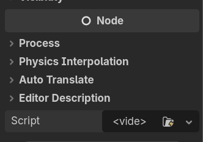
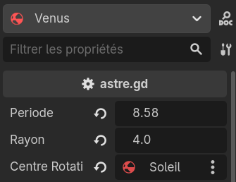
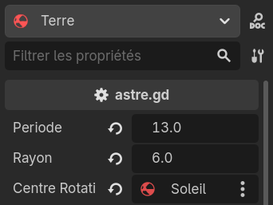
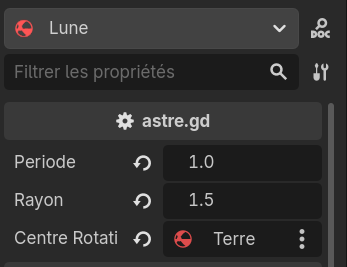

---
contents:
  - "Utilisation d'un moteur de jeu"
  - "Programmation orientée objet"
reading_time: "20 minutes"
ai_image: "../../assets/images/ia/IA_NIA.png"
report_url: "https://forms.office.com/r/ccF1FGKW25"
summary: "Explique comment utiliser le même script sur plusieurs objets."
---

Cette page présente la solution à l'[exercice de la section précédente](./mouvement-analytique.md#exercice-2).

## Réutiliser les scripts

Pour intégrer la Terre et la Lune dans le système, il faut d'abord créer leur hiérarchie d'objets, ce que l'on peut faire en copiant-collant Vénus et en modifiant la couleur. Ensuite, on pourrait faire un script pour chaque astre, mais on répliquerait beaucoup de code. L'idée va être de réutiliser le script de Vénus. On va donc d'abord commencer par le renommer **astre**. Ensuite, en sélectionnant l'objet Terre et Lune, on peut leur ajouter un script dans le bas de la page, dans la section **Node** de l'inspecteur.


/// caption
Ajouter un script à un noeud
///

!!! info "Retirer un script"

    Si vous ajoutez un script qui n'est plus nécessaire, vous pouvez le retirer avec l'option **vider** dans le menu du champs de script. Le menu est accessible par les 3 points.

En attachant le même script à plusieurs nœuds, chaque nœud exécute **sa propre version du script**, que l'on appelle instance. Chaque orbite sera gérée indépendamment. Les valeurs réglées dans l'inspecteur peuvent être personnalisées pour chaque instance du script.

Voici les 3 configurations utilisées pour chacun des astres. Note : le champ `centre rotation` sera ajouté à la prochaine étape.

<div style="display: flex; align-items: center; gap: 0.5rem;" markdown>


/// caption
Configuration du script astre pour Vénus
///


/// caption
Configuration du script astre pour la Terre
///


/// caption
Configuration du script astre pour la Lune
///

</div>

Les périodes de rotation sont ajustées de façon relative les unes aux autres. On verra le pourquoi de ce choix à la prochaine section.

## Bouger le centre de rotation

Pour changer le centre de rotation, il suffit de gérer la rotation comme se faisant autour de l'origine, puis de décaler le centre de rotation après avoir fait les calculs. Pour connaître la position d'un centre de rotation mobile, il faut utiliser une référence vers un autre des objets de la scène.

### Introduire une référence

Pour référer à un autre objet, il faut déclarer une variable du type auquel l'on souhaite faire référence. Dans notre cas, les astres sont des `Node`, mais aussi des `RigidBody3D`. Nous utiliserons ce second type dans cet exemple. Avec la référence, l'on peut accéder aux propriétés en appelant avec un point (.) entre la référence sur le nœud et sa propriété. 

```gdscript title="Ajout de la gestion du centre de rotation" linenums="1"
# Variable pour contenir la référence
@export var centre_rotation : RigidBody3D

func _process(delta: float) -> void:
    position = Vector3(
		rayon * cos(2 * PI / periode * temps),
		0.0,
		rayon * sin(2 * PI / periode * temps)
	)
	
    # Instruction pour déplacer l'objet avec son centre de rotation
	if centre_rotation != null:
		position += centre_rotation.position

    # ...
```

## Structure du projet

Vous pouvez récupérer le projet dans l'état d'avancement de la fin de cette page de notes ici : [:octicons-mark-github-24: Afficher le projet sur GitHub](https://github.com/simulations-astrophysique/orbite-analytique).