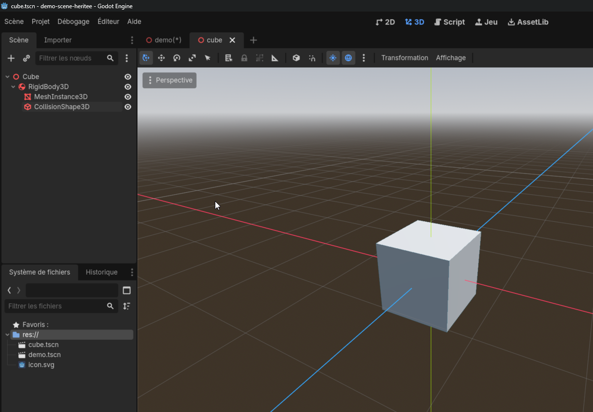
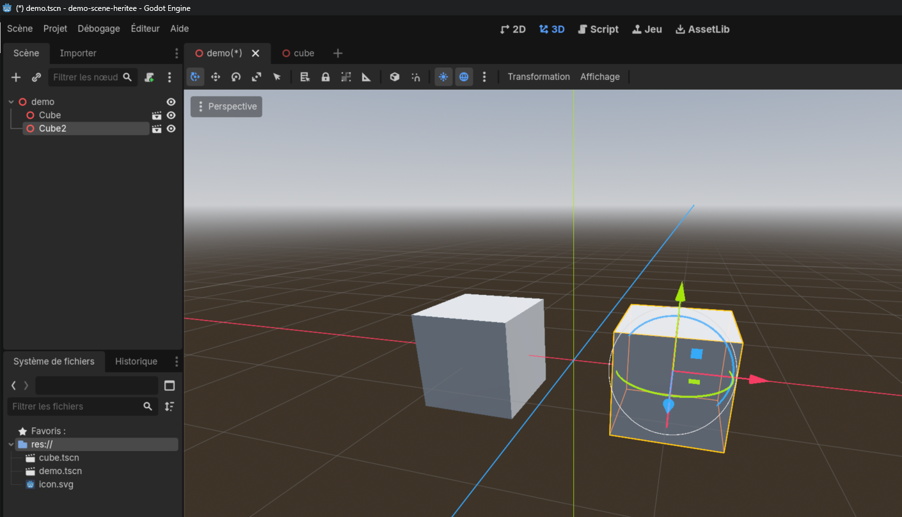
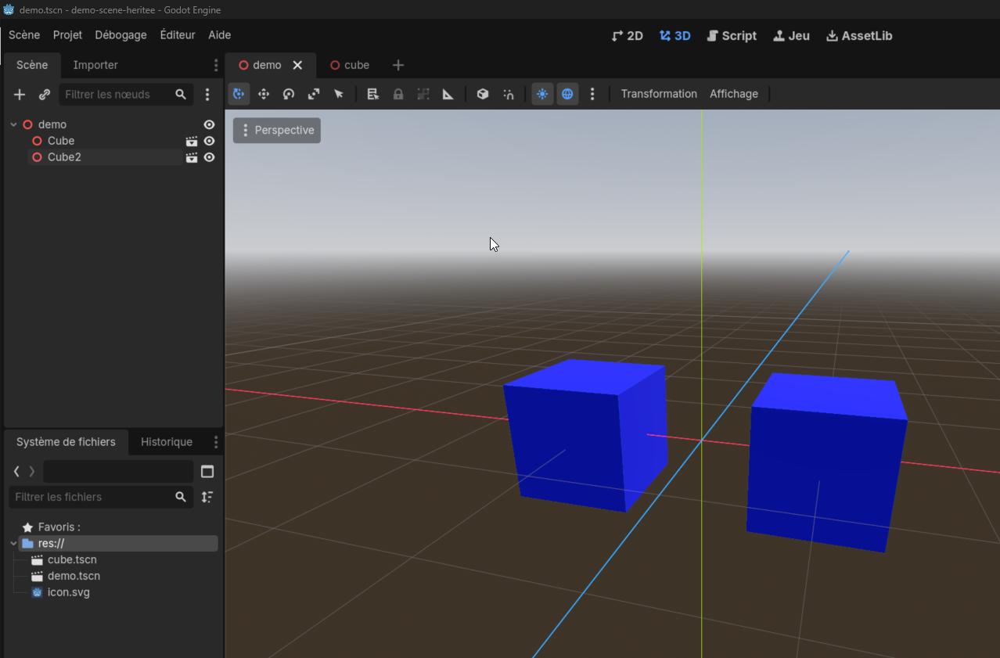
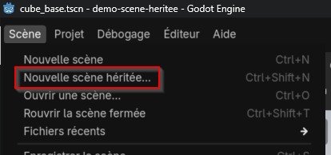
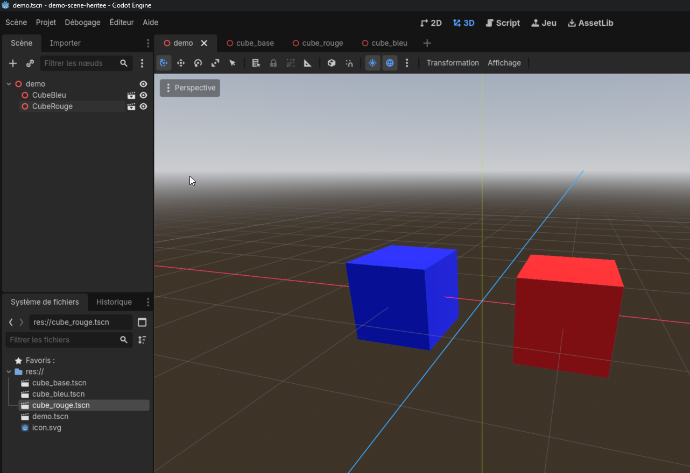
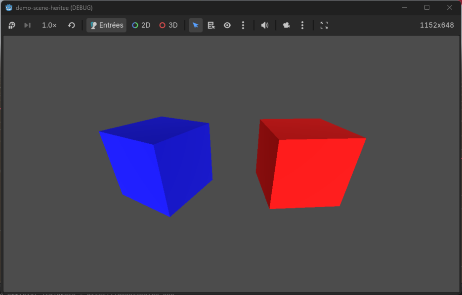

---
contents:
  - "Utilisation d’un moteur de jeu"
  - "Programmation orientée objet"
reading_time: "20 minutes"
ai_image: "../../assets/images/ia/IA_NIA.png"
report_url: "https://forms.office.com/r/ccF1FGKW25"
summary: "Explique comment réutiliser l'information des scènes pour construire des variations."
---


Dans cet exemple, nous partirons d’un projet vide afin de démontrer l’utilisation des scènes héritées. Les scènes héritées permettent de construire plusieurs scènes qui ont une base commune, mais dont on peut personnaliser certaines parties.

Imaginons un exemple où l’on veut présenter deux formes, deux cubes de différente couleur. Par souci d’organisation chaque cube doit être défini dans une scène. On peut commencer en définissant une scène **demo** pour contenir les deux cubes et une scène **cube** qui définit un cube. On crée ensuite deux cubes dans la scène **demo**. Chacun des cubes est une instance de la scène **cube**.

{ width="600" }
/// caption
Structure de la scène cube
///

{ width="600" }
/// caption
Structure de la scène de démonstration avec les deux cubes
///

On souhaite maintenant colorer les cubes en bleu. La propriété de sélection du matériel n’est pas disponible dans l’instance de cube de la scène **demo**. Il faudra donc modifier directement dans la scène **cube** pour y ajouter ce script.

{ width="600" }
/// caption
Structure de la scène de démonstration avec les deux cubes colorés en bleu
///

## Personnaliser les cubes

On souhaite maintenant afficher un cube rouge et un cube bleu. Par contre, on ne veut pas créer une deuxième scène et dupliquer notre cube, car si l’on veut modifier son comportement plus tard (ajouter un script par exemple), on souhaite que les deux cubes aient le même comportement. On va donc créer des **scènes héritées**. Une scène héritée est une copie de la scène de base, sauf pour les éléments que l’on décide de modifier. L’avantage est que les modifications dans la scène de base (celle dont on hérite) se répercutent automatiquement dans toutes les scènes héritées (appelé scènes enfants).

Pour commencer, on va retirer la couleur du cube et renommer cette scène **cube_base**. Ensuite, on va créer une scène héritée, **cube_rouge** et une scène héritée **cube_bleu**. 


/// caption
Menu de création de la scène héritée
///

Dans chacune des scènes enfants, on va modifier la couleur du matériel. Ensuite, on crée une instance de chaque scène enfant dans la scène de démo.


{ width="600" }
/// caption
Structure de la scène de démonstration avec les deux cubes enfants colorés
///

## Modifier les cubes

On souhaite maintenant que les cubes tournent lentement sur eux-mêmes. Pour ce faire, on va ajouter un script **cube**. Comme les deux cubes doivent avoir ce script, on va l’ajouter directement dans la scène **cube_base**.

```gdscript title="cube" linenums="1"
extends Node3D

@export var vitesse_rotation : float

func _process(delta: float) -> void:
	rotation.y += deg_to_rad(delta * vitesse_rotation)
```

!!! warning "Script invisible"

    Si vous avez déjà créer l'instance de la scène enfant avant d'ajouter le script dans le parent, vous ne verrez pas le script s'afficher dans la scène **demo**. Vous devrez supprimer les instances des scènes enfants et les créer de nouveau dans la scène **demo**.

Il ne reste après qu’à indiquer les vitesses de rotation, à ajouter une caméra et une lumière.

{ width="600" }
/// caption
Scène finale avec les deux cubes enfants colorés en rotation
///

## Structure du projet

Vous pouvez récupérer l'état final de la démonstration ici : [:octicons-mark-github-24: Afficher le projet sur GitHub](https://github.com/simulations-astrophysique/demo-scene-heritee).

